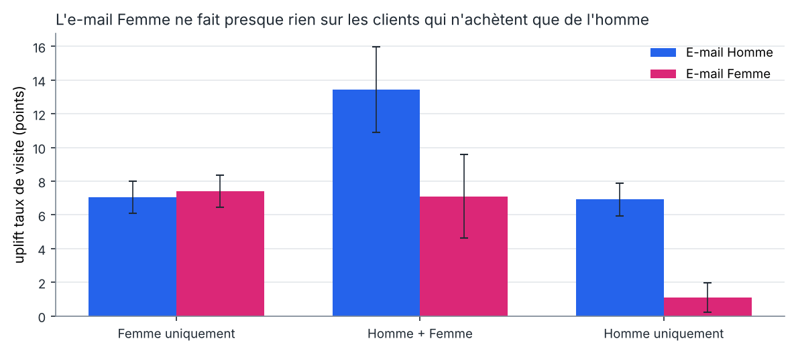
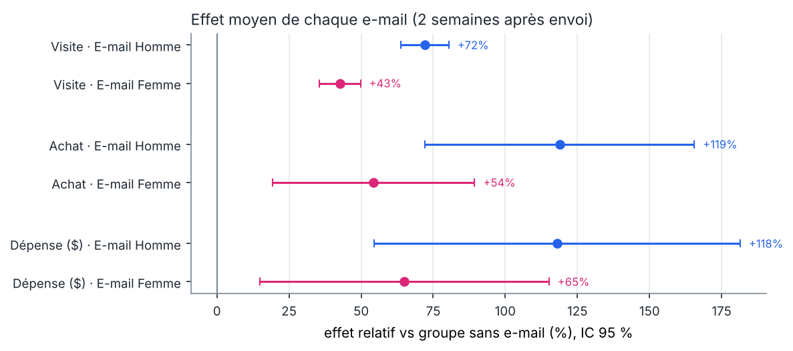
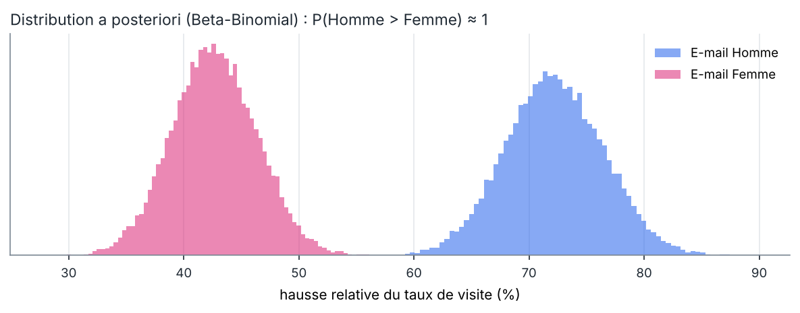
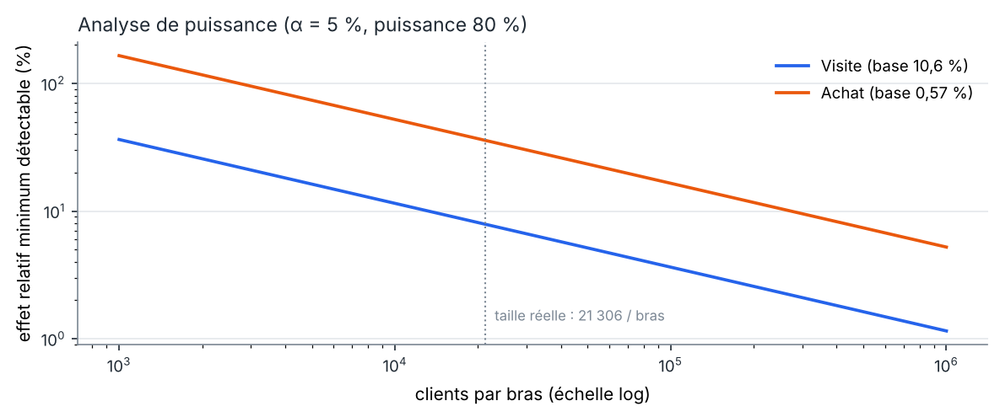
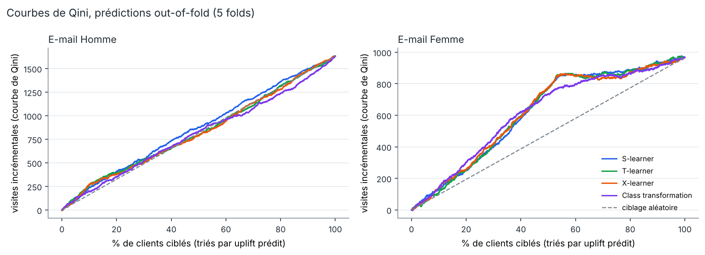
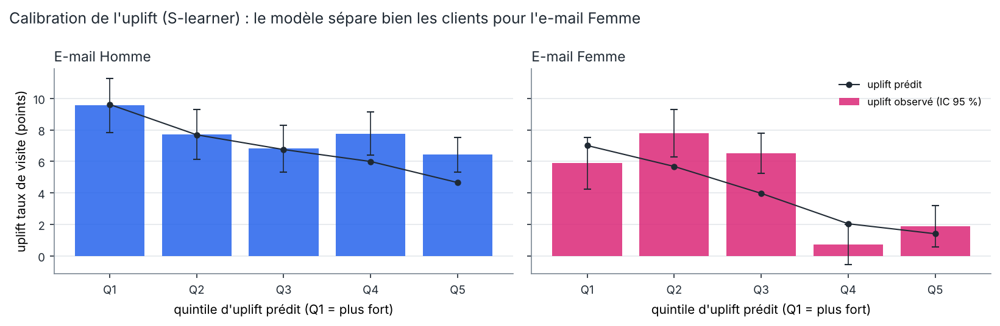
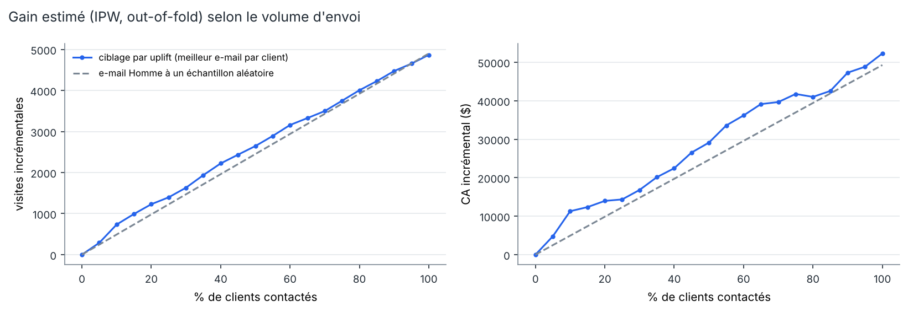

# E-mail Campaign: A/B Testing & Uplift Modeling

Une enseigne de prêt-à-porter a envoyé deux campagnes e-mail à 64 000 clients répartis au hasard en trois groupes : e-mail collection Homme, e-mail collection Femme, aucun e-mail. Le projet répond à trois questions dans l'ordre où un data scientist les traiterait.

1. **L'expérience est-elle fiable, et quel e-mail fonctionne le mieux ?** Lecture statistique de l'A/B/n test.
2. **Pour qui l'e-mail fonctionne-t-il ?** Modèles d'uplift (effet causal individuel) évalués par courbes de Qini.
3. **Qui faut-il contacter, et avec quel e-mail ?** Évaluation hors-ligne de politiques de ciblage, avec intervalles de confiance.



## Résultats clés

- L'expérience est saine : répartition conforme au 1/3–1/3–1/3 (test SRM, p = 0,90), groupes équilibrés sur toutes les variables (|SMD| max = 0,014).
- **L'e-mail Homme gagne sur toutes les métriques.** Taux de visite +7,7 points (+72 %), taux d'achat ×2,2, +0,77 $ de chiffre d'affaires par client. Face à l'e-mail Femme, il génère +21 % de visites (p ajustée Holm < 10⁻¹⁶, probabilité bayésienne d'être meilleur > 99,99 %).
- **L'effet est hétérogène.** L'e-mail Femme n'apporte que +1,1 point de visite aux clients qui n'achètent que de l'homme, contre +7 points chez les autres. L'e-mail Homme, lui, fonctionne partout et double son effet chez les clients qui achètent dans les deux rayons (+13,4 points).
- **Les modèles d'uplift détectent cette hétérogénéité** pour l'e-mail Femme (Qini AUC ≈ 0,05 pour les 4 méta-learners). Pour l'e-mail Homme, l'effet est trop homogène pour qu'un modèle apporte beaucoup.
- **Conclusion business :** à volume constant, envoyer l'e-mail Homme à tous est quasi optimal pour les visites (+4 900 visites, +49 k$ sur deux semaines). La personnalisation par modèle n'ajoute pas de visites, mais un gain de chiffre d'affaires de +3,0 k$ (IC 95 % [+0,6 k$ ; +6,0 k$]) qu'il faut confirmer par un nouveau test avant de l'industrialiser. Sous contrainte de volume, cibler 10 % des clients par uplift capte 15 % des visites incrémentales, soit 1,5 fois mieux qu'un tirage aléatoire.

## 1. Analyse de l'expérience

### Contrôles de validité
| Contrôle | Résultat |
|---|---|
| Tailles des groupes | 21 306 / 21 307 / 21 387 |
| Sample Ratio Mismatch (χ²) | p = 0,90, pas de déséquilibre |
| Équilibre des covariables | \|SMD\| max = 0,014 (seuil usuel 0,1) |

### Effets moyens (IC 95 %, p-values corrigées par Holm sur les 9 tests)
| Métrique | Sans e-mail | E-mail Homme | E-mail Femme |
|---|---:|---:|---:|
| Taux de visite | 10,6 % | 18,3 % (+7,7 pts [7,0 ; 8,3]) | 15,1 % (+4,5 pts [3,9 ; 5,2]) |
| Taux d'achat | 0,57 % | 1,25 % (+0,68 pt [0,50 ; 0,86]) | 0,88 % (+0,31 pt [0,15 ; 0,47]) |
| Dépense / client | 0,65 $ | 1,42 $ (+0,77 $ [0,49 ; 1,05]) | 1,08 $ (+0,42 $ [0,17 ; 0,68]) |



Méthodes utilisées :
- **Test de Welch** et IC de la différence, IC de l'effet relatif par la méthode delta.
- **Bootstrap** pour la dépense, très asymétrique (99 % de zéros, maximum à 499 $). Il confirme l'IC paramétrique ([0,49 ; 1,05] pour l'e-mail Homme).
- **Ajustement par régression** (estimateur de Lin 2013, principe de CUPED) avec erreurs robustes HC2. La réduction de variance n'est ici que de 3 % : les variables disponibles avant l'envoi prédisent mal la visite. C'est un résultat en soi, qui indique qu'il faudrait une métrique pré-période plus proche du résultat (visites passées, par exemple).
- **Lecture bayésienne** (Beta-Binomiale) : hausse du taux de visite de +72 % [64 ; 81] pour l'e-mail Homme, +43 % [36 ; 50] pour l'e-mail Femme.



### Puissance statistique
Avec 21 306 clients par groupe, l'effet minimum détectable est de 7,9 % en relatif sur la visite, mais de **36 %** sur l'achat (taux de base 0,57 %). Les effets observés ici sont assez gros pour être détectés. En revanche, un futur test visant +20 % d'achats nécessiterait environ 75 000 clients par groupe : l'achat ne peut pas servir de métrique principale à cette taille d'échantillon.



## 2. Modèles d'uplift

L'uplift estime l'effet causal de l'e-mail pour chaque client, τ(x) = P(visite | x, e-mail) − P(visite | x, pas d'e-mail). Il ne s'observe jamais individuellement : chaque client n'a reçu qu'une seule version.

Quatre méta-learners ont été implémentés à la main sur une base LightGBM :
- **S-learner** : un seul modèle, le traitement comme variable.
- **T-learner** : un modèle par groupe.
- **X-learner** (Künzel et al., 2019) : impute des effets individuels puis les régresse.
- **Class transformation** (Jaskowski & Jaroszewicz, 2012) : modélise directement l'uplift via Z = YT + (1−Y)(1−T).

Toutes les prédictions sont **out-of-fold** (cross-fitting 5 folds) : chaque client est scoré par un modèle qui ne l'a jamais vu. Les métriques sont implémentées dans `metrics.py` et vérifiées dans les tests contre `scikit-uplift`.

| Learner | Qini AUC Homme | Qini AUC Femme | Uplift top 10 % Homme | Uplift top 10 % Femme |
|---|---:|---:|---:|---:|
| S-learner | **0,018** | **0,052** | 11,2 pts | 6,2 pts |
| T-learner | 0,006 | 0,052 | 12,4 pts | 5,1 pts |
| X-learner | 0,003 | 0,052 | 12,5 pts | 6,4 pts |
| Class transformation | −0,003 | 0,051 | 9,4 pts | 6,6 pts |
| *Effet moyen (référence)* | | | *7,7 pts* | *4,5 pts* |



Le découpage par quintile d'uplift prédit montre ce que le modèle a appris. Pour l'e-mail Femme, les 3 premiers quintiles ont un uplift de 6 à 8 points, les 2 derniers de moins de 2 points : le modèle isole bien les clients sur qui cet e-mail ne marche pas. Pour l'e-mail Homme, l'uplift observé reste entre 6,4 et 9,6 points : il y a un léger gradient, mais tous les clients réagissent.



## 3. Politique de ciblage

Comme l'affectation était aléatoire avec des probabilités connues, la valeur de n'importe quelle règle de ciblage peut être estimée sans biais sur les données existantes par **pondération inverse (IPW)**. Les intervalles sont obtenus par bootstrap (1 000 tirages).

| Politique (64 000 clients, 2 semaines) | Clients contactés | Visites incrémentales | CA incrémental |
|---|---:|---:|---:|
| E-mail Femme à tous | 100 % | +2 895 [2 440 ; 3 312] | +27,2 k$ |
| E-mail Homme à tous | 100 % | +4 902 [4 463 ; 5 364] | +49,3 k$ |
| Règle métier : Femme aux acheteuses Femme, Homme aux autres | 100 % | +5 021 [4 566 ; 5 475] | +49,9 k$ |
| Uplift : meilleur e-mail pour chaque client | 100 % | +4 868 [4 435 ; 5 330] | +52,3 k$ |
| E-mail Homme à 30 % tirés au hasard | 30 % | +1 471 | +14,8 k$ |
| Uplift : top 30 % | 30 % | +1 631 | +16,8 k$ |

Comparaisons directes :
- Uplift (meilleur e-mail) vs e-mail Homme à tous : **−34 visites** [−121 ; +47], **+3 008 $** [+616 ; +6 018].
- Uplift top 30 % vs 30 % au hasard : +160 visites [−68 ; +385], non significatif.
- Règle métier vs e-mail Homme à tous : +120 visites [−228 ; +456], non significatif.



**Recommandation.** Envoyer l'e-mail Homme à toute la base. Le gain de chiffre d'affaires de la personnalisation provient de 2,7 % des clients basculés sur l'e-mail Femme. Il est statistiquement significatif, mais il a été sélectionné parmi plusieurs comparaisons sur les mêmes données : il faut le valider par un test dédié (politique uplift vs e-mail Homme à tous) avant de l'industrialiser. Si la pression marketing impose de limiter les envois, le classement par uplift est la bonne façon de choisir qui contacter en priorité.

## Limites
- Les hyperparamètres des learners (arbres très peu profonds, fortement régularisés) ont été choisis parmi 3 configurations au vu du Qini en validation croisée. Ce léger biais de sélection serait levé par une validation imbriquée ou un jeu de test réservé.
- L'uplift est modélisé sur la visite, seule métrique assez fréquente. L'achat (0,9 %) et la dépense sont trop rares pour un modèle d'uplift fiable à cette taille d'échantillon.
- Les données datent de 2008 et ne contiennent que 7 variables client.

## Lancer le projet

```bash
git clone https://github.com/martinprevot/email-campaign-uplift.git
cd email-campaign-uplift
pip install -r requirements.txt

python scripts/run_analysis.py   # analyse complète, ~30 s
pytest -q                        # tests (la comparaison avec scikit-uplift est ignorée si le paquet est absent)
```

## Structure

```
├── data/raw/hillstrom.csv         # jeu de données MineThatData (checksum vérifié)
├── src/campaign_uplift/
│   ├── data.py                    # chargement, encodage
│   ├── experiment.py              # SRM, SMD, Welch, delta, CUPED/Lin, Holm, bayésien, puissance
│   ├── learners.py                # S-, T-, X-learner, class transformation
│   ├── crossfit.py                # prédictions out-of-fold pour chaque e-mail
│   ├── metrics.py                 # courbes de Qini et d'uplift, Qini AUC, uplift@k
│   ├── policy.py                  # évaluation IPW de politiques de ciblage
│   └── plots.py
├── scripts/run_analysis.py        # pipeline complet
├── tests/                         # couverture des IC, biais IPW, learners sur données simulées
└── reports/                       # résultats JSON/CSV et figures
```

## Stack
Python · pandas · NumPy · SciPy · statsmodels · scikit-learn · LightGBM · Matplotlib · pytest

## Source des données
Kevin Hillstrom, *MineThatData E-Mail Analytics And Data Mining Challenge*, 2008.
